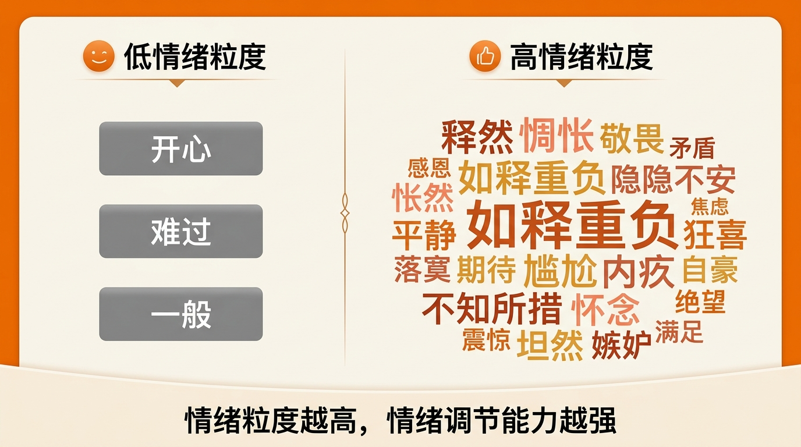
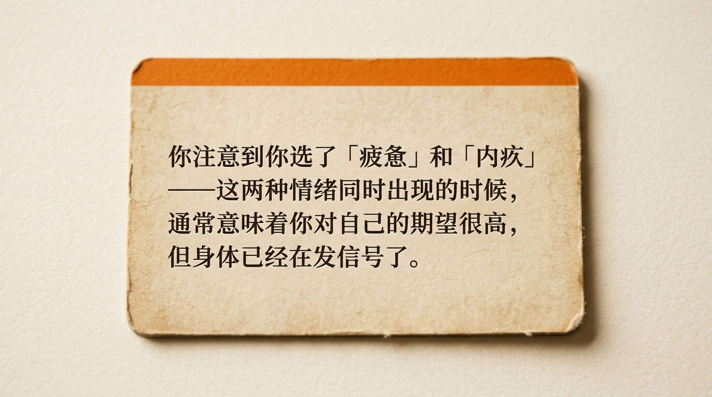
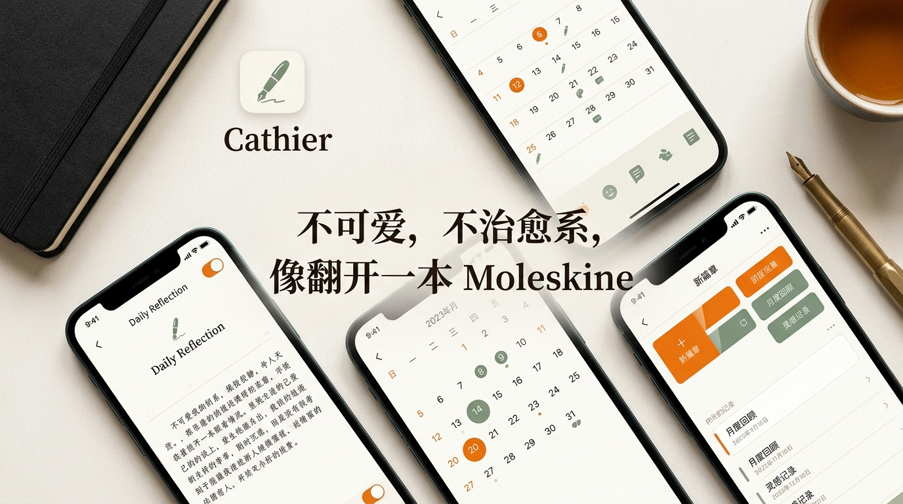

一个月前朋友推荐了一个叫 Cathier 的 App，说是"情绪感知训练"。

第一反应：又一个心情日记？

用了之后发现完全不是那么回事。

**它不问你心情好不好。它问的第一个问题是：你的身体哪里有感觉？**

这个切入点一下子就不一样了。

我们习惯用头脑去"判断"自己的情绪——"我应该没事"、"这不算什么"、"我只是有点累"。但身体不会骗人。当你注意到每次焦虑的时候胃都在发紧，你就很难再告诉自己"没事"了。

**第二步更有意思：从80多个词里选出你的情绪。**

不是"开心/难过/一般"三选一，而是"释然、惆怅、敬畏、矛盾、如释重负、隐隐不安"这种级别的精准度。

第一天我花了很长时间选——因为我发现自己平时根本不知道该用什么词来描述感受。这本身就是一个发现。

心理学上有个概念叫"情绪粒度"（emotional granularity）——能越精准地命名情绪的人，情绪调节能力越强。不是因为命名本身有魔力，而是因为精准命名的过程就是在"看见"。

**第三步是 AI 反馈。**

这是我没想到会喜欢的功能。它不会说"你要坚强"、"明天会更好"这种话。它会说类似这样的东西：

> "你注意到你选了'疲惫'和'内疚'——这两种情绪同时出现的时候，通常意味着你对自己的期望很高，但身体已经在发信号了。"

就是这种——不给建议，但帮你"看见"的感觉。

**一个月之后的意外收获：**

积累到30次签到的时候，解锁了"模式洞察"。AI 分析了我所有的签到数据，告诉我一些我自己从来没注意到的规律。

比如我的焦虑在周三最高——后来想想确实是每周中间最忙的时候。比如"轻松"出现之前，通常有运动记录。比如我的"愤怒"几乎从不单独出现，总是跟"无力感"配对。

这些东西，靠写日记永远发现不了。

**关于设计：**

最后说一下这个 App 的设计。它不可爱，不治愈系，不用马卡龙色。打开的感觉像翻开一本 Moleskine 笔记本——暖色纸质底，安静的排版，橙色点缀。

这个设计传递的态度是：你不是一个需要被哄的人，你是一个想要更了解自己的人。

**总结：**

如果你想快速记个心情，市面上有很多更简单的选择。

但如果你真的想训练自己的情绪觉察能力——从身体开始感受、学会精准命名、用 AI 发现自己都不知道的模式——Cathier 目前是我见过最好的方案。

免费，无广告，数据存本地。App Store 搜"Cathier"。
